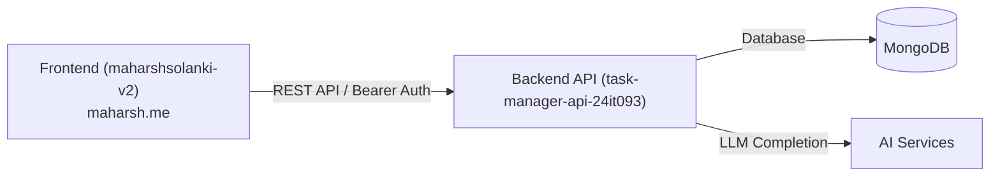

# Maharsh Solanki - Portfolio Ecosystem (24IT093)

Central index repository connecting the live portfolio deployment, frontend client, and backend API services.

---

## 🌐 Live Deployment
- **Production Portfolio:** [maharsh.me](https://maharsh.me)

---

## 📦 Repositories

### 1. Frontend Client
- **Repository:** [maharsh-tech/maharshsolanki-v2](https://github.com/maharsh-tech/maharshsolanki-v2)
- **Stack:** React 19, Vite, React Router
- **Role:** Web client interface and personal portfolio showcase.

### 2. Backend API
- **Repository:** [maharsh-tech/task-manager-api-24it093](https://github.com/maharsh-tech/task-manager-api-24it093)
- **Stack:** Node.js, Express, MongoDB (Mongoose), JWT Authentication
- **Role:** REST API powering authentication, task data management, and external service integrations.

---

## 🏗️ Architecture Overview

